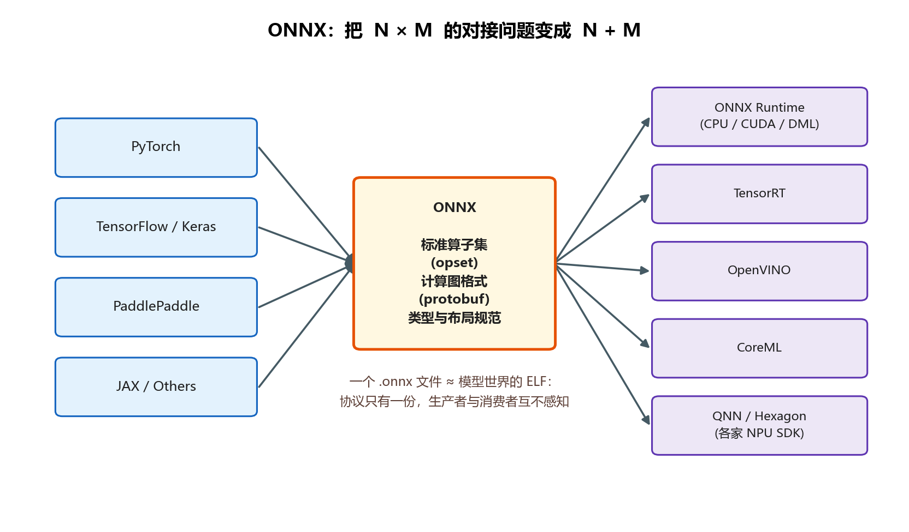
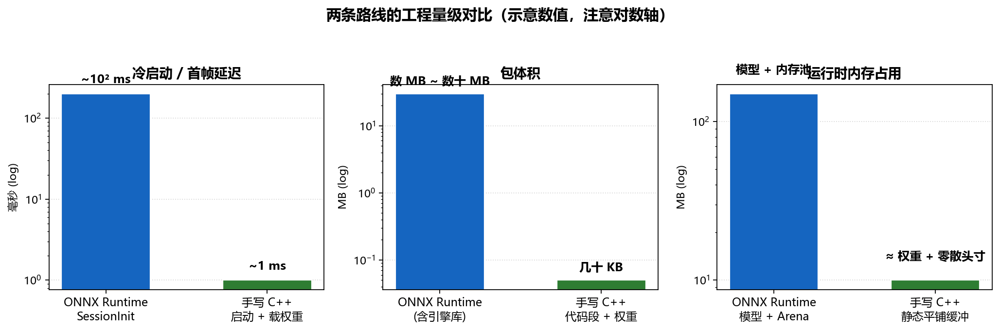
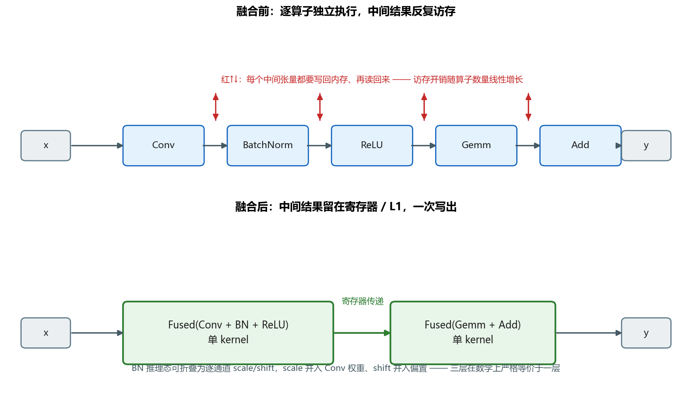
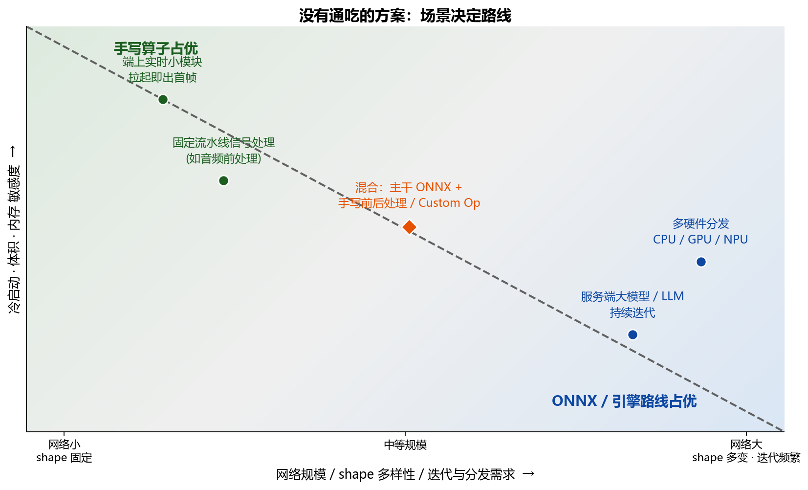

# 一个基本问题 - 当我们谈论移植的时候，我们聊的是 ONNX 还是自定义算子？

> 这篇笔记不讨论哪条路线“更先进”，只记录一个实际选型问题：模型离开训练框架以后，究竟应该交给通用推理引擎，还是把它改写成项目自己的 C++ 实现。

面试时我常问这个问题。我关心的是，对方能不能把“能跑”和“适合长期维护”分开看。很多项目一开始只是照着现成方案接进去，等到包体积、启动时间或某个算子性能出了问题，才发现当初其实已经做了取舍。

所以这里的“移植”，不只是换一个文件格式。它更像是在两套成本之间做选择：一套成本由运行时和通用性承担，另一套成本由自己的代码、测试和维护承担。

## 一、ONNX 到底做了一件什么事

先从模型离开训练框架后的处境说起。

我们在 PyTorch 里训练模型，享受的是动态图、Python 生态、随时 print 随时调试。但部署环境——一个可能没有 Python、没有 torch、甚至没有文件系统的进程——什么都没有。训练与部署之间需要一次"交接"。交接最朴素的方式是序列化：把权重存下来，把结构描述出来。问题在于，每家框架的序列化格式都是私有方言：PyTorch 有 TorchScript 和 `.pt`，TensorFlow 有 SavedModel 和 `.pb`，互不相认。而部署端的推理引擎又层出不穷：ONNX Runtime、TensorRT、OpenVINO、CoreML、DirectML、各家 NPU 的私有 SDK……如果每个框架都要为每种引擎各写一条导出通道，对接复杂度是 **N × M** 的；在中间垫一层公共格式，它就变成 **N + M**。

ONNX（Open Neural Network Exchange）就是这层公共格式。具体来说，它负责三件事：

1. **定义了一套标准算子集（operator set，简称 opset）**：Conv、Gemm、BatchNormalization、Relu……每个算子的语义、输入输出、数值行为都有书面规范，并按版本演进（opset 13、17、18……）。
2. **定义了一张计算图格式**：用 protobuf 描述节点（NodeProto）、张量（ValueInfoProto）、权重（Initializer），以及它们之间的连接关系。一个 `.onnx` 文件本质上就是一段序列化后的 protobuf。
3. **定义了类型与张量规范**：数据类型、布局约定、广播规则。

可以把它看成模型领域的交换文件：训练框架负责把图和权重写出来，推理引擎负责把它读进去。双方不必直接适配彼此，只要共同遵守这份格式即可。它能普及，主要也是因为这个生态位置，而不是因为它在每一种设备上都能做到最好。

这里有一个几乎所有初学者都会混淆、但一问就露馅的点：**ONNX 只是一个格式，它自己不会执行任何东西**。真正让模型跑起来的是推理引擎，最常见的就是 ONNX Runtime（下文简称 ORT）。前者是协议，后者是实现，就像 JSON 和某个 JSON 解析器的关系。我们日常说"用 onnx 跑"，省略掉的主语几乎都是 ONNX Runtime。

那么这条路线的优势和代价分别是什么？

先看它为什么常常是默认选项。实际项目里，通常看重的是三点：格式标准，工具链成熟，以及性能能够满足要求。

- **标准**：一次导出，处处可跑（至少在纸面上）。跨框架、跨引擎、跨操作系统。
- **成熟**：ORT 背后是大量工程师十几年打磨的图优化器、算子融合 Pass，以及接驳成熟的 kernel 库（CPU 上有 MLAS 一系，移动端常用 XNNPACK）。你几乎不可能在同等工时内手写出比它更稳、覆盖面更广的实现。
- **快得足够**：对绝大多数 PC 端、服务端场景，ORT 的默认性能已经在业务容忍范围之内；而且它提供 Execution Provider（EP）机制——CUDA、TensorRT、DirectML、CoreML、QNN——同一个 `.onnx` 几乎零改动就能下发到 GPU 甚至 NPU。

再说代价。代价不在"能不能跑"，而在你为这份通用性交出的东西：

- **需要随程序带上一个引擎**。ORT 的运行时库在几 MB 到几十 MB 量级；进程里多一个运行时、多一套内存管理、多一份需要跟随版本升级的依赖。
- **它是黑盒**。算子怎么调度、内存怎么分配、某个算子为什么慢——你能影响的只有配置项，改不动内核逻辑。
- **它有明显的冷启动开销**。创建 `InferenceSession` 要读文件、反序列化 protobuf、构建计算图、跑图优化、初始化内存池（Memory Arena），这一整套 SessionInit 在稍大的模型上轻松达到几十到几百毫秒。对常驻服务这无所谓；对"进程拉起就要出首帧结果"的场景，这是硬伤。
- **通用 kernel 不是最快的 kernel**。通用实现要处理任意 shape、任意 stride、任意布局，就必然带着守护逻辑和调度开销。针对固定形状手工铺开的 SIMD 代码，单算子上比通用实现快出两三倍并不稀奇——只是过去很少有人有预算去写而已。

如果项目对这些成本比较敏感，就会自然地考虑另一种做法。

## 二、另一条路：把网络"翻译"成 C++

另一种做法是不要在设备上解析模型图，而是把固定的计算顺序直接写进 C++。卷积可以用直接卷积或 `im2col + GEMM`，推理态的 BatchNormalization 可以改成逐通道的仿射变换，权重则作为二进制数据随程序发布。这样，模型结构不再是运行时读取的图，而是代码里的调用关系。

这就是**手写算子 / 自定义算子路线**：模型的"图"被编译进了你的源代码，运行时只剩数据。

这条路线的主要成本在验证，而不只是写出第一版：一个几十层的网络，每一层都要和 PyTorch 的参考输出逐层对齐，误差超过 1e-5 就得排查是布局错了、精度错了还是实现错了。这套逐层对齐的流程磨人、重复、极考验耐心，人力成本以"人月"计。所以过去它只出现在极端场景：算法竞赛冲榜、嵌入式硬实时，或者报价足够好的项目。

过去这条路线最费时间的是验证，写出第一版反而只是开始。几十层网络需要逐层拿 C++ 输出和 PyTorch 参考结果对齐，误差不对时，还要区分布局、精度和实现本身的问题。现在可以把这部分流程自动化：生成实现和单测，逐层比较结果，再根据失败节点继续排查。这样做并没有消除工程成本，但把人工从重复比对中解放出来，手写实现才值得在具体场景里和 ONNX 方案认真比较。

这条路线的成本和收益大致如下：

- **冷启动极快**：没有图要解析、没有 session 要初始化，权重甚至可以直接编进二进制的 `.rodata` 段，进程起来函数就能跑，首帧延迟在微秒到毫秒级。
- **内存极省、体积极小**：没有引擎、没有 arena，所有中间缓冲区在编译期静态平铺，运行时零动态分配（zero-allocation）；产物只有代码段加权重，几十 KB 是常态。
- **可定制到指令级**：shape 是固定的，你就可以为这一个 shape 写最极致的 SIMD（AVX-512 / NEON），寄存器怎么用、循环怎么展开、预取怎么排，全部自己说了算。

但它的劣势同样醒目：

- **没有人帮你做算子融合**。逐层独立实现的后果是每一层的输出都要写回内存、下一层再读出来，内存往返的开销可能吃掉你在计算上省下的全部功夫（这正是引擎们花大力气做融合的原因，下一节展开）。
- **在"极致吞吐"这个维度上，人力几乎不可能赢过框架**。ORT 的 kernel 库和融合 Pass 是几十个工程师按年头堆出来的；你一个人为一个网络重写的版本，在单算子上可能更快，在整体吞吐上大概率更慢。
- **硬件加速器要自己对接**。想让模型跑进 NPU，ONNX 路线改一个 EP 配置；手写路线意味着去啃 Hexagon SDK 或 CoreML C API 的原生文档。
- **shape 一变，一切重来**。图写死在代码里，输入尺寸、序列长度、batch 的任何变化都可能触发重写；维护风险从"改配置"变成"改代码"。

## 三、两条路线对比

前两节分别说明了两种做法，这里把主要差异放在一起比较。先看总表，再解释几个容易影响选型的因素。

| 性能维度 | ONNX Runtime 方案 | 原生 C++ 纯手写转写方案 | 胜出方 |
| --- | --- | --- | --- |
| 算子融合 & 图优化 | 自动进行算子融合（如 Conv+BN+ReLU 融合成一个 Kernel，减少内存读写） | 需手动实现融合逻辑，否则每次算子写回内存开销极大 | ONNX |
| 极致单算子耗时 | 依赖通用 Kernel 库（如 XNNPACK、Eigen），通用性强但有微小调度开销 | 可针对固定输入 Shape 手动写极致的 SIMD (AVX/NEON) 或汇编优化 | 手写 C++ |
| 内存与缓存利用率 | 内置算子间内存重用（Memory Arena）分配器，减少碎片 | 静态分配/平铺全局内存缓冲区，几乎零动态分配开销（Zero-Allocation） | 手写 C++ |
| NPU / 硬件加速器调用 | 通过 Execution Provider (QNN, CoreML, DirectML) 自动下发给 NPU | 需手动调用厂商的原生 C API/SDK (如 Hexagon SDK/CoreML C API) | ONNX（开发成本上） |
| 冷启动 & 初始化耗时 | 需要加载 .onnx 模型、解析计算图、分配内存，有明显的 SessionInit 延迟 | 模型结构为硬编码逻辑，只加载权重，首帧响应速度极快 | 手写 C++ |
| 包体积 / 运行时内存占用 | 包含 Runtime 引擎库，二进制文件较大（通常数 MB 至数十 MB） | 极轻量，只有算法逻辑的代码段和二进制权重，二进制体积可小至几十 KB | 手写 C++ |

量级的直观感受可以看下面这张图（注意纵轴是对数尺度——差距不是百分之几十，是数量级）：

### 融合为什么值钱

表格中的第一项经常被低估。要理解算子融合为什么值钱，得先接受一个现代硬件的基本事实：**算力涨得比带宽快**。卷积、矩阵乘这类计算在现代 CPU/GPU 上效率极高，反倒是"把中间结果写到内存、再从内存读回来"这个动作越来越贵。一个 Conv→BN→ReLU 的组合，如果各自独立执行，中间要经历两轮完整的内存往返；而 BN 在推理态可以折叠成逐通道的 scale + shift，scale 进一步并入 Conv 的权重、shift 并入偏置——三层在数学上严格等价于一层，中间结果从头到尾留在寄存器里，一次写出。手写路线也能做融合，但每种组合都需要自己推导、实现和维护。使用引擎时，这部分工作由图优化 Pass 完成。

### 冷启动的账

相对而言，手写路线在冷启动和包体积上更有优势。SessionInit 的开销构成——文件 IO、protobuf 反序列化、建图、图优化、arena 初始化——每一项单独看都不大，串起来却是一整段不可忽略的延迟；而在手写方案里，"模型"就是代码本身，冷启动退化成普通的进程启动加一次权重加载（权重嵌进二进制时连这次加载都不存在）。同样，包体积的差距也不是优化能弥合的：引擎本身就是几 MB 起步的死重，而手写产物的下限只有纯代码段加权重数据。

### 胜负表是死的，场景是活的

表格里的优劣不能简单相加。真正需要先问的是：项目在乎冷启动和包体积吗？输入 shape 会不会变化？是否要依赖 NPU？模型还会不会频繁迭代？如果是常驻服务，SessionInit 往往可以摊平；如果是端上短进程，它就可能直接影响体验。路线的差别，最终取决于这些约束，而不是某一项指标单独胜出。

## 四、选了 ONNX 路线，还有一门必修课

如果项目最后采用 ONNX 路线，还需要补齐两件事：熟悉围绕 `.onnx` 文件的分析工具，以及理解推理引擎会怎样优化计算图。本节先讨论 PC 端；端侧还有更多平台相关问题，另文再展开。

### 工具链：导出后的检查与分析

模型导出后，很多训练框架里的调试手段就不再直接可用。PC 端通常会用下面这些工具检查模型：

- **Netron**：可视化查看器，几乎是所有人的第一站。把 `.onnx` 拖进去，整张计算图、每个节点的属性、初始权重、推断出的形状一目了然。导出后第一件事就是打开它确认图长得对不对——BN 有没有被折叠、有没有意外插入的 Transpose、图是不是断成了不支持的 subgraph。
- **onnx.checker / onnx.shape_inference**：官方 Python 包里的结构合法性与形状推断工具。前者验证图是否符合规范（很多"引擎加载失败"其实是导出时图就非法），后者把动态形状尽可能推断成静态，也是许多后续优化的前置步骤。
- **onnxsim（onnx-simplifier）**：常量折叠与图化简的离线工具，把导出过程中遗留的冗余节点（Identity、多余的 Slice、可计算的常量子图）收拾干净。跑一遍 onnxsim 再进引擎，是性价比最高的五分钟。
- **onnx-modifier**：可视化改图工具，删节点、改属性、改初始值，救急用。
- **ONNX Runtime 的 profiling**：`SessionOptions` 打开 profile 之后会产出每个节点的耗时报告——当模型"不知道为什么慢"的时候，不要猜，先看这份报告：慢在哪个算子、跑在哪个 EP 上，一目了然。

这些工具解决的是同一个问题：让导出前后的模型都能检查、能定位。这样遇到性能或结果异常时，可以先确认问题出在模型、导出过程，还是推理引擎。

### 图优化：为什么等价变换会影响性能

图优化不只是打开一个开关。它实际执行的是一组图重写：数学结果保持等价，同时尽量降低执行开销。引擎拿到 `.onnx` 后并不会立刻执行，而是先跑若干轮这样的重写，主要分四类：

1. **冗余消除**：常量折叠（子图输入全是常量就直接算掉）、死代码消除（输出不可达的节点删掉）、公共子表达式合并。
2. **算子融合**：纵向的（Conv+BN+ReLU 合成一个 kernel）和横向的（两个并行的逐元素操作合并）。原理上一小节已经讲过——本质是把内存往返换成寄存器传递。
3. **布局与内存优化**：NCHW/NHWC 的转换决策、算子间内存复用规划（arena 里同一块 buffer 让给生命周期不重叠的中间张量复用）。
4. **形状固化**：把动态 shape 特化成静态，从而解锁更激进的 kernel 选择。

为什么需要这个过程？因为现代网络里存在大量**胶水算子与逐元素算子**——Reshape、Squeeze、Gather、Add、Mul——它们单独执行时的开销几乎全在 kernel 启动和内存读写上，真正的计算量趋近于零。不融合它们，调度开销就会成为吞吐的天花板；融合之后，图执行起来才是"计算密集"而非"访存密集"。训练框架不需要在乎这个（一次训练跑几千步，启动开销早就摊薄了），部署引擎必须在乎。

在 ORT 里，这些行为由 `GraphOptimizationLevel`（`DISABLE_ALL` / `BASIC` / `EXTENDED` / `ALL`，默认全开）控制，也可以通过 ORT format model 把部分优化提前到离线阶段。手写路线只是把同一项工作放到了编译前：由开发者决定哪些节点融合、怎样安排缓冲区和循环。两种方案都在减少调度和内存访问，区别在于这部分工作由引擎自动完成，还是由项目代码承担。

## 五、回到那个基本问题

回到面试和项目评审里的“移植”这个词。评估时不能只看导出了哪个文件，还要看方案带来的成本和能力：

- **ONNX 路线**：用包体积、内存占用、冷启动延迟和黑盒属性，换成熟稳定、免费获得的优化、跨硬件分发能力和低维护成本。这就是获得通用性的主要成本。
- **手写路线**：用工时（自动化工具可以减少其中一部分重复工作，但不能替代验证和维护）、融合与优化的自主责任、硬件对接的原始成本，换冷启动、内存、体积上的极致控制，以及固定 shape 下的指令级自由。这就是获得专用性的主要成本。

实际项目很少能同时把所有指标都做到最好；如果两边的优点都要，通常意味着更多开发和维护投入。实践中还有大量工程落在中间地带：主干走 ONNX、前后处理手写；或者把手写的极致 kernel 注册成 ORT 的 Custom Op，让引擎调度它——融合路线的收益与自动化的调度兼得。

那个面试问题我至今没听到过标准答案，因为具体选哪条路线，要看项目场景：一个进程常驻、模型几十层、要跑在三张显卡上的服务，和一个拉起即出结果、塞进几十 KB 产物里的端上模块，"移植"两个字在两个项目里指的是完全不同的东西。我更关心的是：当时为什么选 ONNX？如果输入 shape、启动方式或硬件条件发生变化，是否还会继续选它？

把模型接通只是第一步。后续评审和维护时，还需要说清楚当初的选型依据，以及哪些条件变化后应该重新评估。
