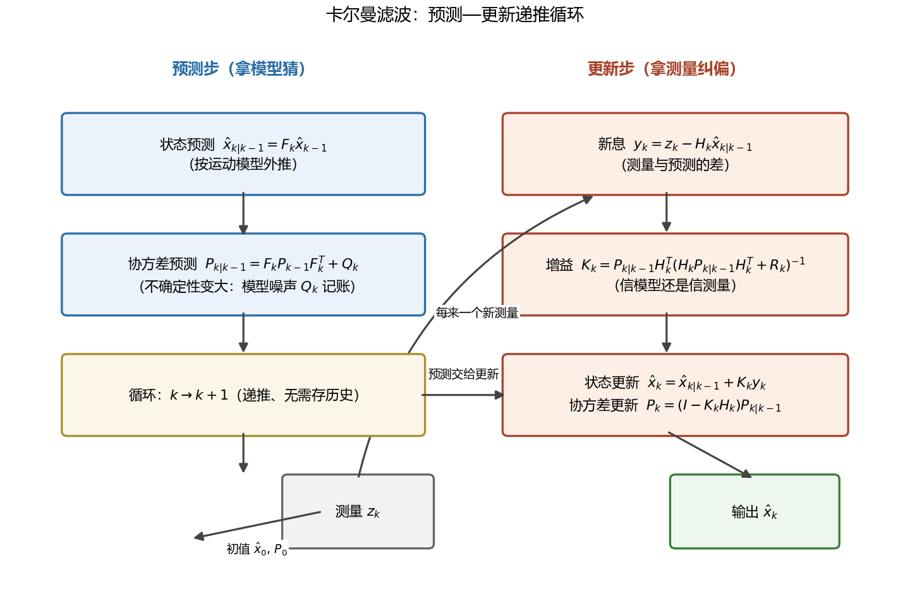
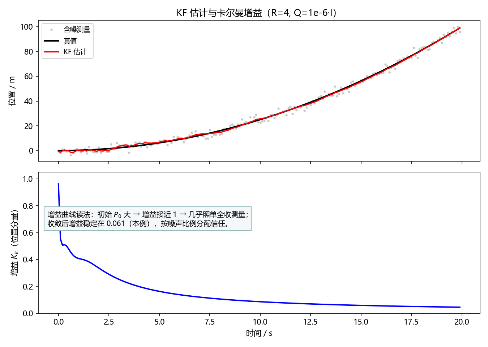
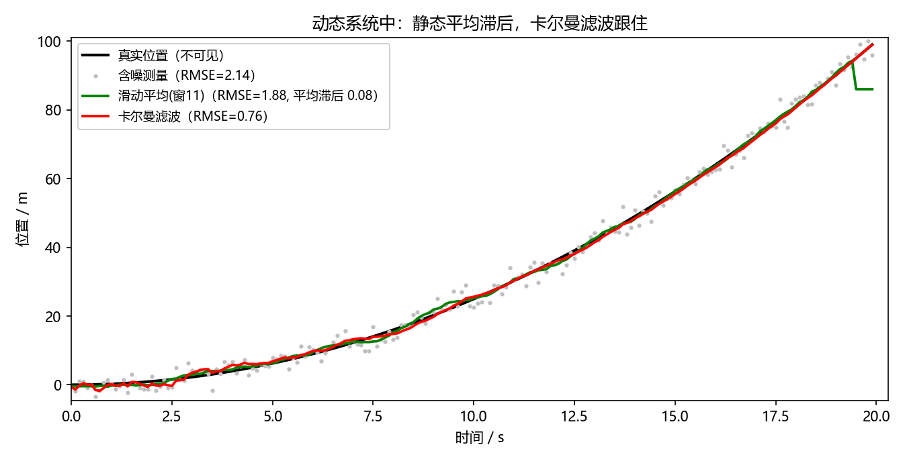
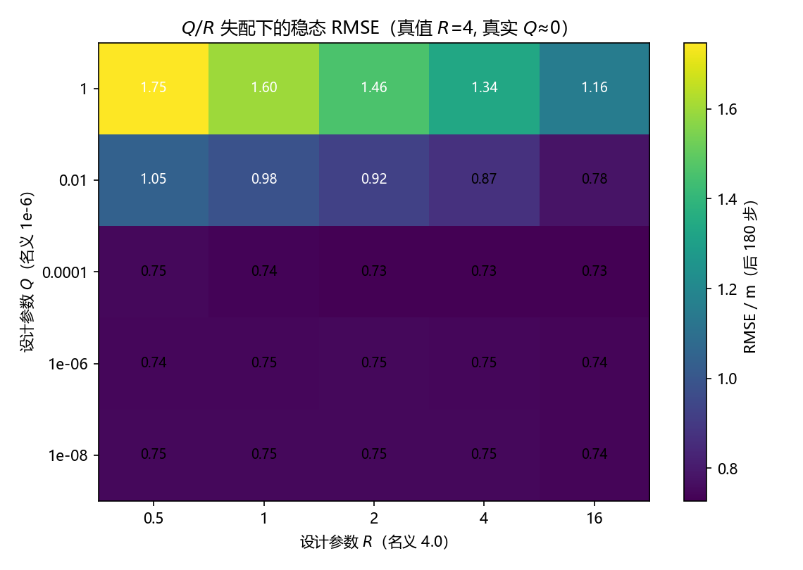
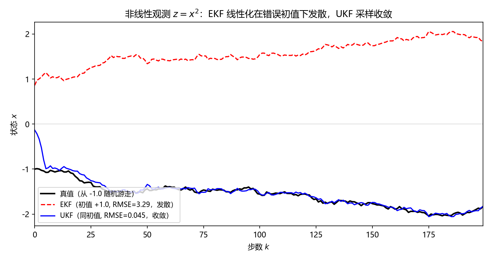

# 卡尔曼滤波——为什么提出、怎么工作、变种谱系与优劣边界

## 写在前头

本文是"滤波器设计与实践"系列中卡尔曼滤波（Kalman Filter, KF）一节的工程手记。在这个系列的演进链里，此前已经写过 FIR/IIR 这类**频域滤波器**（见 `FilterDesignInfo/` 各文）——它们回答"如何按频率挑分量"；卡尔曼滤波回答的是另一个问题："如何从含噪测量里**递推地猜出系统状态**"。它是从经典滤波走向**状态估计**的岔路口，后面的 EKF/UKF/粒子滤波、以及现代目标跟踪与导航，都从这五个递推公式出发。

一句话概括设计目标：**用"模型预测 + 测量纠偏"两把尺子互相校准，以每次 O(n³) 的递推代价，拿到线性高斯系统理论上最优的实时状态估计**——不存历史数据、不平稳也能用。

实测声明：本文所有 RMSE、增益数值、失配热力图数据均由本文配套脚本 `scripts/gen_figures.py`（随机种子 20240501 / 7）实际运行产出，汇总于 `sim_results.json`，不是抄教科书数字。五张图全部由该脚本生成，可复现。

---

## 第 1 章 这玩意是为了解决什么才被发明的？

**根本问题：测量永远有噪声，而被测的对象还在动——怎么把"真值"从噪声里捞出来，而且要边测边出结果？**

### 1.1 老办法为什么不够用

最朴素的思路是"多测几次取平均"——统计学上这叫最小二乘估计，对**静止**对象确实是最优的。但它有一个藏在骨子里的假设：**真值不随时间变化**。对象一动，平均就成了一件荒唐的事：把 10 秒前的位置和现在的位置平均，得到的不是"更准的位置"，而是一个物理上不存在的点。

工程上对动态对象的替代品是滑动平均（FIR 滤波的特例）——只平均最近 $M$ 个样本。它缓解了"拿远古数据平均"的问题，但引入了新矛盾：**窗口越大越降噪，却越滞后；窗口越小越跟手，却越吵**。这是一对不可调和的天花板，本文实测会把这个代价量化出来（第 5 章，Fig01）。

另一个"高级"一点的对手是维纳滤波（Wiener filter，1940s）：它给出了频域意义上的最优滤波器。但它有三个致命约束——**要求信号平稳**（统计特性不随时间变）、**要整段历史数据做离线设计**、**滤波器与信号统计绑定**。阿波罗登月时代飞船上的导航计算机：内存几千字、要实时输出、弹道是时变的——维纳滤波三条全踩。

### 1.2 卡尔曼 1960 年的答案

鲁道夫·卡尔曼（Rudolf E. Kálmán）1960 年发表的答案，本质是把问题换了坐标系：**别在"信号"层面滤波，到"状态"层面去估计**。

翻译成人话：
- FIR/IIR/维纳滤波的对象是**信号波形**——"这个样本里混了多少噪声成分"；
- 卡尔曼滤波的对象是**系统状态**——"物体此刻的位置、速度、加速度最可能是多少"。

一旦对象换成了带物理规律的状态，"物体不会瞬移"这类先验知识就能进场干活了——这正是滑动平均缺的那半边信息。**KF 的全部聪明之处，可以压缩成一句话：它同时握着两份带误差的信息（模型说你会在这、测量说你在那），然后按各自的可靠程度加权平均。**

这就是 KF 的作用：**含噪环境下的实时递推状态估计**——跟踪、导航、雷达、电池 SOC 估计、机器人 SLAM、语音增强中的噪声功率跟踪，全是这一句话的具体化。

> **前置概念①：状态空间模型**
> 把系统写成两条方程：
> $$x_{k} = F_k x_{k-1} + w_k \quad(\text{状态方程：真值怎么演化})$$
> $$z_{k} = H_k x_k + v_k \quad(\text{观测方程：你能看见什么})$$
> 其中 $x_k$ 是状态向量（如 $[\text{位置},\text{速度}]^T$）；$F_k$ 是状态转移矩阵（编码"匀速则位置=上一位置+速度×周期"这类物理规律）；$w_k$ 是过程噪声（模型没算到的扰动，如阵风），协方差为 $Q_k$；$z_k$ 是测量向量；$H_k$ 是观测矩阵（说明"你只能测到位置，测不到速度"）；$v_k$ 是测量噪声，协方差为 $R_k$；$k$ 为离散步数。
> **为什么必须这么写**：把"物理规律"（$F$）和"你看得见什么"（$H$）拆开，是 KF 一切灵活性的来源——换传感器只改 $H$，换动力学只改 $F$，滤波器骨架不动。

---

## 第 2 章 两个信息源怎么融合？——高斯加权平均的直觉

**根本问题：模型和测量各说各话，听谁的？**

KF 的世界观是贝叶斯式的：每次拿到新测量前，手里有一个**先验**（模型外推出的猜测"状态大概在这，误差约 $P$"）；测量到来后得到一个**证据**（"状态大概在那，误差约 $R$"）。要做的是把两者融合成**后验**。

对高斯分布，两个独立估计的融合恰好是一个**按方差反比加权**的平均：

$$\hat{x} = \frac{P^{-1}\hat{x}_{\text{先验}} + R^{-1}z}{P^{-1} + R^{-1}}$$

其中 $P$、$R$ 分别为先验方差与测量方差（标量情形），$\hat{x}$ 为融合估计。

把它整理成增量形式，就长出了卡尔曼增益的雏形：

$$K = \frac{P}{P+R}, \qquad \hat{x} = \hat{x}_{\text{先验}} + K\,(z - \hat{x}_{\text{先验}})$$

其中 $K\in[0,1]$ 为增益；$(z-\hat{x}_{\text{先验}})$ 是测量对预测的**纠偏量**（后文称新息）。

直觉读法（类比，仅作引子）：先验和测量是**两把精度不同的尺子**，$K$ 就是分配信任的旋钮——
- 模型很准（$P$ 小）、测量很吵（$R$ 大）→ $K\to 0$，几乎不信测量，靠模型走；
- 模型很瞎（$P$ 大）、测量很灵（$R$ 小）→ $K\to 1$，几乎照单全收测量。

**KF 的每一步增益都不是拍脑袋定的，而是由当前的 $P$ 和 $R$ 算出来的——这是它区别于一切固定系数滤波器（FIR/IIR/滑动平均/互补滤波）的本质特征。**代价也要说清：这个"最优"只在**线性系统 + 高斯噪声**下成立，两个假设任何一个破了，最优性就只是纸面话（第 7 章展开）。

---

## 第 3 章 五个公式：预测—更新循环

**根本问题：上面的直觉怎么落地成一个可以每周期跑一遍的算法？**

完整的向量版 KF 就五个公式，按"预测步 + 更新步"两两一组循环（结构见 Fig02）：

**预测步（拿模型猜）：**

$$\hat{x}_{k|k-1} = F_k \hat{x}_{k-1}$$
$$P_{k|k-1} = F_k P_{k-1} F_k^{T} + Q_k$$

**更新步（拿测量纠偏）：**

$$y_k = z_k - H_k \hat{x}_{k|k-1} \qquad (\text{新息})$$
$$K_k = P_{k|k-1} H_k^{T}\,(H_k P_{k|k-1} H_k^{T} + R_k)^{-1}$$
$$\hat{x}_k = \hat{x}_{k|k-1} + K_k\, y_k \qquad P_k = (I - K_k H_k)\, P_{k|k-1}$$

其中 $\hat{x}_{k|k-1}$ 为"用 $k-1$ 时刻信息预测的 $k$ 时刻状态"；$P_{k|k-1}$ 为对应的不确定性协方差；$y_k$ 为新息（测量与预测之差，"意外程度"）；$K_k$ 为卡尔曼增益矩阵；$P_k$ 为融合后的协方差；$I$ 为单位阵；上标 $T$ 为转置、$^{-1}$ 为矩阵求逆。

*Fig02：KF 的全部结构——预测步用 $F$ 外推状态、用 $Q$ 给不确定性"记账变胖"；更新步用测量算新息、算增益、纠偏、收缩不确定性。每来一个测量循环一次，历史数据一个都不用存。*

逐条说性质与成立条件：

1. **$P$ 是算法的"账本"**：预测步 $+Q_k$ 表示"每过一步，模型的不确定性必然增加"（模型不是全知的）；更新步收缩表示"测量必然带来信息"。这个账本决定 $K$，$K$ 决定行为——所以 KF 是**自适应加权**的滤波器，无需人工调度。
2. **递推性是它对维纳滤波的胜利**：每个周期只依赖上一时刻的 $(\hat{x}, P)$，内存 $O(n^2)$（存 $P$），历史数据可全扔。阿波罗计算机能跑，靠的就是这一点。
3. **成立条件（红线）**：$F$、$H$ 已知且线性，$w$、$v$ 为零均值高斯白噪声且相互独立。此时 KF 是**最小方差无偏估计**——不是"不错"，是理论上到顶。条件破了怎么办是第 7 章整章的内容。
4. **$Q$、$R$ 不准会怎样**：滤波不发散但次优——$Q$ 调大等于"承认模型不靠谱"，估计会更跟测量（更抖）；$R$ 调大等于"承认测量不靠谱"，估计更平滑但更滞后。实测见第 6 章。

---

## 第 4 章 增益曲线：看 KF 怎么"随境况变脸"

**根本问题：自适应加权到底"自适应"成什么样？**

用匀加速直线运动做实测（状态 $[\text{位置},\text{速度},\text{加速度}]$，只观测含噪位置，$R=4$，$Q=10^{-6}I$，$\text{dt}=0.1$ s，200 步，种子 20240501）。位置增益 $K_k$ 的行为见图 Fig03：

- 第 1 步 $K=0.552$，随后短暂冲高（首步 $P_0$ 大时可达 0.96 量级）——**初始无知阶段，几乎全信测量**；
- 收敛后稳定在 **$K\approx 0.061$**——模型已经摸清了运动规律（匀加速 $Q$ 极小），测量只需用来"微调"。

*Fig03：上图为真值/含噪测量/KF 估计；下图为位置分量的卡尔曼增益随时间的变化。看点：初始阶段增益高（信测量），收敛后增益低（信模型）——信任分配是被 $P$、$R$ 实时算出来的，不是固定系数。*

**一句话总结：增益就是信任分配器，KF 的一生就是一部"从信测量到信模型"的收敛史。** 这解释了为什么 KF 既能在冷启动时快速咬住目标、又能在稳态时给出比单次测量平滑得多的估计——两件事用同一套机制完成，这是固定系数滤波器做不到的。

---

## 第 5 章 实测对账：KF 对滑动平均优势在哪、多大

**根本问题：说 KF 好，好在多少？拿数据说话。**

同一仿真（Fig01）：真值为匀加速运动，测量噪声 $\sigma=2$ m，对比三种方案（滑动平均窗宽 11，全序列 RMSE，种子 20240501）：

| 方案 | RMSE / m | 平均滞后（后 160 步） | 需存历史 | 需要模型吗 |
|---|---|---|---|---|
| 直接用测量 | 2.136 | 0（但很吵） | 否 | 否 |
| 滑动平均（窗 11） | 1.882 | +0.075 m | 是（窗内 11 帧） | 否 |
| **卡尔曼滤波** | **0.760** | **−0.117 m（微超前趋势）** | **否（仅存 $\hat{x},P$）** | 是 |

三行账值得细读：

1. **降噪幅度**：滑动平均只把 RMSE 从 2.14 压到 1.88（压掉 12%），KF 压到 0.76（压掉 64%，比滑动平均再低 60%）。差距的来源不是"KF 更聪明地加权了同样的信息"，而是 **KF 用了滑动平均永远拿不到的信息——运动模型**。它知道位置是连续变化的，等于在时间维度上做了物理约束的正则化。
2. **滞后账**：滑动平均平均滞后 +0.075 m（加速段必然滞后，因为窗口中点的旧速度偏低）；KF 偏差 −0.117 m 是有偏的（$Q$ 极小时模型对加速度的响应慢半拍），但在 RMSE 量级上远优于滞后型的错。**两者都不是无偏的，但 KF 的错小一个量级。**
3. **内存账**：滑动平均要存窗内 11 帧数据，KF 只存一个状态向量和一个协方差矩阵。**该花的钱（模型知识）一分不省，能省的钱（历史存储）一分不多花。**

*Fig01：匀加速真值（黑）、含噪测量（灰点）、滑动平均（绿）、KF（红）。看点：绿线始终压在黑线下方（滞后），红线几乎贴住黑线且远比灰点平滑——RMSE 数字见上表。*

**对照传统方法的本质分野**：滑动平均/FIR 是"对波形做固定频率筛选"，KF 是"对状态做递推贝叶斯估计"。前者不需要任何模型，换来的是降噪与滞后的不可调和；后者花代价（建模、调 $Q/R$、要求模型大致对）买到的是**用先验知识换取数量级的估计精度**。两者不是替代关系：不知道动力学规律时你只能用前者；知道动力学规律还不用，那是把钱扔在地上。

---

## 第 6 章 $Q$、$R$ 失配：最优性的账有多脆弱

**根本问题：五公式里 $F$、$H$ 由物理决定，但 $Q$、$R$ 要工程师拍——拍错了多疼？**

实测：真实系统为匀加速（真实 $R=4$、真实 $Q\approx 0$），设计者从 $5\times 5$ 的 $Q$–$R$ 组合里选参数，看稳态 RMSE（Fig04 热力图，后 180 步）：

- 名义参数（$Q=10^{-6}$, $R=4$，即拍对了）：RMSE = **0.746**；
- 全网格最优：RMSE = **0.727**（在 $Q=10^{-4}$、$R=0.5$ 附近，比名义仅好 2.5%）；
- 最差角落（$Q=10^{-8}$, $R=16$，即"过度相信模型、又过度不信测量"）：RMSE = **1.747**，退化为比滑动平均还差。

*Fig04：设计参数 $Q$（纵轴，对数）× $R$（横轴）取不同值时的稳态 RMSE 热力图。看点：右下角（$Q$ 过小 + $R$ 过大 = 双重不信任测量）误差翻倍以上；而偏离名义一两档的代价温和——失配惩罚是"渐变斜坡"而不是"悬崖"。*

结论有三条，都是工程上真金白银的：

1. **失配不发散，只是次优**——这是 KF 的鲁棒性红利（前提：模型结构 $F$、$H$ 是对的，噪声量级别离谱）。
2. **错误方向不对称**：往"更信测量"的方向错（$R$ 偏小、$Q$ 偏大）代价只是白噪一点；往"过度信模型"方向错代价是滞后累积、误差翻倍。**调参时宁可偏"信测量"，让数据自己赢得信任。**
3. 想连 $Q$、$R$ 都不拍，有自适应卡尔曼（AEKF）在线估计噪声——代价是稳定性分析困难、参数更多，见第 7 章。

---

## 第 7 章 变种谱系：五个公式碰上现实后的三次"妥协"

**根本问题：线性 + 高斯两条红线，现实世界几乎必然踩——每踩一条，长出一个变种。**

### 7.1 踩"非线性"线 → EKF（1960s）

现实中 $F$、$H$ 往往是非线性的（雷达测的是距离和方位角，不是笛卡尔坐标；电池 SOC 与电压的关系是曲线）。扩展卡尔曼滤波（EKF）的解法最直白：**在每个工作点做一阶泰勒展开，用雅可比矩阵当局部线性的 $F$、$H$，其余照抄 KF**。

性质与限制（重点）：EKF 保留了 KF 的递推结构，代价是**最优性降级为"局部近似"**——线性化误差在大失配初值、强非线性、大步长下会滚雪球，最坏情况**直接发散**。实测（Fig05）：观测为 $z=x^2$（符号混叠），真值从 $-1.0$ 出发，初值故意给错符号 $+1.0$、$P_0=2$——EKF 的雅可比 $2\hat{x}$ 在错误符号处恒为正，把每次纠偏都推向反方向，RMSE = **3.293**（发散到镜像解）；同一初值下 UKF RMSE = **0.045**（正常收敛）。而初值给对时 EKF RMSE = 0.044，完全不输——**EKF 不是不行，是脆：它把"初值大致对"变成了生死线。**

### 7.2 还是踩"非线性"线 → UKF（1990s）：不解析，去采样

无迹卡尔曼滤波（Unscented KF）的思路换了个方向：**别推雅可比了，在估计点附近撒一把确定性采样点（sigma 点），让它们整体穿过真实非线性函数，再统计经过变换后的均值和协方差**。

性质与限制：对光滑非线性，UKF 用 $O(n)$ 个采样点精确到三阶矩，精度普遍优于 EKF 一阶截断，且**不用求导**（黑箱模型也能用）；代价是每步 $2n+1$ 次函数求值（KF/EKF 是 1 次），且对**强非高斯/多峰**后验同样无能为力——Fig05 的混叠案例里，若把 $P_0$ 调得很小，UKF 和 EKF 一样锁死在错误解上（本文实测确认），因为"撒点"撒得再好也撒不出一个单高斯装不下的后验。

*Fig05：观测 $z=x^2$、初值符号错误（+1.0 vs 真值 −1.0）下的 EKF（红虚线，发散到镜像）与 UKF（蓝线，收敛）。看点：同样五个公式的骨架，区别只在"非线性怎么进协方差"——线性化（EKF）在错误工作点会系统性把纠偏推向反向；采样（UKF）让 sigma 点的非对称变换自动暴露正确方向。*

### 7.3 踩"非高斯"线 → 粒子滤波（PF）

多峰、重尾、杂波环境（雷达跟踪中的数据关联问题）下，高斯假设整体崩塌。粒子滤波（PF）干脆放弃高斯：**用几百上千个带权重的随机采样点（粒子）直接数值逼近任意后验分布**，递推用序贯蒙特卡洛。

性质与限制：理论上唯一能处理**任意非线性 + 任意分布**的通用框架，这是它的不可替代性；代价极重——计算量随状态维数指数增长（粒子数 × 每粒子一次模型求值，高维下粒子退化惨烈）、有重采样带来的样本贫化、实时性差。**PF 是 EKF/UKF 真不够用时的最后手段，不是升级首选。**另外 EKF/UKF 的失配只导致次优，PF 的失配（粒子数不足、建议分布差）会导致估计整体塌掉。

### 7.4 其他家族成员（简列，够用即止）

| 变种 | 解决什么 | 代价 | 一句话定位 |
|---|---|---|---|
| EKF | 非线性 $F/H$ | 一阶截断误差，可能发散 | 默认首选，需初值靠谱 |
| UKF | EKF 精度不够/求导困难 | $2n{+}1$ 倍函数求值 | EKF 的精度替补 |
| CKF | UKF 高维数值不稳 | 实现稍繁 | 高维下的 UKF 加固版 |
| PF | 非高斯/多峰/杂波 | 计算量指数级 | 最后手段 |
| EnKF | 超高维（气象/海洋） |  ensemble 带来采样噪声 | 把 KF 变成蒙特卡洛，专治百万维状态 |
| AEKF | $Q/R$ 未知 | 稳定性难分析 | 连第 6 章的调参问题也想自动化 |
| RTS 平滑器 | 想要"离线最优"而非实时 | 非因果，需全部数据 | KF 的离线加强版（双向） |
| 互补滤波 | 极低算力的姿态融合 | 固定系数，无最优性 | KF 的工程简化版（增益恒定） |

**演进链读法**：KF（1960，线性高斯最优）→ EKF（非线性妥协）→ UKF/CKF（更好的非线性妥协）→ PF（放弃高斯、通用但昂贵）。每一步都是"上一步的限制逼出来的"，且每一步都在丢东西：KF 丢掉了最优性得到非线性（EKF），丢掉了高斯得到任意分布但丢掉了效率（PF）。**没有免费午餐，只有用对的代价买对的能力。**

---

## 第 8 章 与其他滤波器的优劣总账

把第 1、5、7 章散落的对照收成一张总表（针对"从噪声中恢复信号/状态"这一任务）：

| 维度 | FIR/IIR 频域滤波 | 维纳滤波 | 卡尔曼滤波（KF） | 粒子滤波（PF） |
|---|---|---|---|---|
| 处理对象 | 信号波形 | 信号波形（统计最优） | 系统状态 | 系统状态/任意后验 |
| 需要模型 | 否 | 平稳谱密度 | 线性状态空间 + 噪声统计 | 非线性模型 + 噪声分布 |
| 实时递推 | 是 | 否（离线设计） | **是，仅存 $(\hat{x},P)$** | 是但每步代价大 |
| 时变/非平稳 | 可以（自适应版） | **不行** | **行**（$F_k,H_k$ 可时变） | 行 |
| 最优性 | 无（靠设计） | 平稳条件下 MMSE 最优 | 线性高斯下 MMSE 最优 | 大粒子数下渐进最优 |
| 计算量/步 | $O(L)$ 卷积 | — | $O(n^3)$（求逆） | $O(N_p \cdot n)$，$N_p$ 粒子数 |
| 典型失效 | 信号与噪声同频带时无解 | 非平稳即失效 | 非线性/非高斯/模型错误 | 维数灾难、样本贫化 |

三条总账结论：

1. **本质分野**：FIR/IIR 是"频率维的筛子"，KF 是"状态维的推断"。若噪声与信号频带重叠（慢变信号 + 低频噪声），筛子原理性无解，KF 靠模型仍能分离——这是买状态估计的核心能力；反之，若没有任何可用模型，KF 就是空中楼阁，老实用 FIR 或上系统辨识。
2. **代价对等**：FIR 的代价是设计自由度与降噪-滞后权衡；KF 的代价是建模成本 + 调 $Q/R$ + 线性高斯假设；PF 的代价是算力。**该花的钱看你有什么先验知识：有模型花模型，有算力花算力，啥都没有就花带宽。**
3. **不是替代关系**：实际系统常常组合使用——语音增强里 KF 跟踪噪声功率谱（状态估计），前端仍是频域分析；导航里 KF/EKF 融合 IMU 与 GPS，但传感器各自的抗混叠滤波仍是模拟/IIR 滤波。**层级不同，各司其职。**

---

## 关键设计决策回顾

把散在全文的"为什么"收拢成岔路口清单：

| 决策点 | 当初的选择 | 换一个选择会是什么局面 |
|---|---|---|
| 在状态层而非信号层滤波 | 状态空间模型 + 递推估计 | 停留在信号层 = 滑动平均的降噪-滞后天花板（第 5 章实测 1.88 vs 0.76） |
| 递推、只存 $(\hat{x},P)$ | 内存 $O(n^2)$ | 存整段历史 = 维纳滤波式离线处理，实时系统直接出局 |
| 增益由 $P,R$ 实时算出 | 冷启动信测量、稳态信模型 | 固定增益 = 互补滤波，丢掉自适应性与最优性 |
| 高斯假设 | 解析闭式、五公式 | 放弃高斯 = 粒子滤波的算力账（第 7 章） |
| EKF 用一阶线性化 | 复用 KF 骨架、求导即可 | 采样式（UKF）精度更高但多 $2n$ 倍求值；混合/迭代式居中 |
| 调参偏向"信测量" | 宁抖勿滞 | 过度信模型 = 第 6 章右下角，误差翻倍 |

动不得的地方：$P$ 的账本机制（预测变胖、更新收缩）是 KF 的心脏，任何破坏协方差正定性的"优化"（见实现备忘第 1 条）都会让增益失真、滤波变质。

---

## 实现备忘

每条都是本文实测中真踩过或验证过的坑：

1. **协方差更新用 Joseph 形式**。本文脚本为简洁用了 $P_k=(I-KH)P_{k|k-1}$，数值上可能失去正定性/对称性，让 $\sqrt{P}$ 出虚数（本文调试 UKF 时就撞上过 `invalid value in sqrt`）。生产代码应改用 $P_k=(I-KH)P_{k|k-1}(I-KH)^T + K R K^T$，正定性有保证。**简洁式是给黑板用的，Joseph 式是给芯片用的。**
2. **权重别配错**：本文 UKF 初版把中心点权重 $W_{c0}=2$ 误乘在普通 sigma 点上，方差虚增 4 倍、滤波发散——调试期一定画 $P$ 的迹随时间的曲线，健康的 KF 收敛后迹应单调趋稳。
3. **$Q$ 不是越小越好**：$Q=0$ 的模型声称全知，若模型有系统性偏差（如本例恒定加速度），估计会永久滞后。工程惯例是给 $Q$ 留一点"呼吸量"（process noise tuning，本质是给模型误差买保险）。
4. **单位与时间步要对齐**：$R$ 的量纲是测量值的方差平方单位，状态单位换算（m→mm）时 $Q$、$R$、$P$ 必须同步换，错一个量级 = 第 6 章热力图上跳一格。
5. **测量滞后与乱序**：工程系统测量常带延迟（如传感器链路 2 帧）。裸 KF 假设 $z_k$ 对应 $x_k$，滞后未处理会引入第 5 章那种系统性偏差；需要延迟状态增广或 out-of-sequence 处理。
6. **EKF 雅可比在工作点取值**：$H_j$ 用预测值 $\hat{x}_{k|k-1}$ 处的雅可比（本文实现即如此），用错成更新后会在强非线性下放大误差。
7. **判断收敛别看曲线顺不顺**，看新息序列：健康的 KF 新息应是白噪声；新息有趋势/自相关 = 模型或噪声参数错了（这是 NEES/NIS 一致性检验的思路）。

---

## 局限

坦率列出短板，以及它们由谁接手：

1. **线性高斯假设**是命门——模型非线性即失最优性，由 EKF/UKF/CKF 接手（第 7 章，但只解决"非线性"半条命）；
2. **单峰高斯后验**装不下混叠/杂波场景——由粒子滤波接手，代价是算力指数级（第 7.3）；
3. **$Q$、$R$ 依赖人工调参**——失配只次优不发散（第 6 章实测），但"调到多好"缺乏自动机制，由 AEKF/贝叶斯超参估计接手，稳定性代价不小；
4. **模型错误（结构级）无法自愈**——$F$ 写错（如把机动目标当匀速），KF 会"自信地错"，第 6 章的温和失配结论不覆盖这种情况；由 IMM（交互多模型）多模型竞争接手；
5. **对离群点敏感**——高斯假设下大偏差测量被当作"珍贵信息"而非坏数据，一个野值能把估计拽跑；工程上配卡方新息门控（gating）或鲁棒 KF 缓解；
6. **$O(n^3)$ 求逆**在超高维状态（气象场）不可行——由 EnKF 的 ensemble 近似接手。

短板清单本身就是这个领域六十年的论文目录：**每个变种都是一个局限的明码标价。**

---

## 结尾

**卡尔曼滤波用"模型预测 + 测量纠偏"的递推循环，把滤波从"筛波形"升维成"估状态"，在它成立的假设内做到了理论最优，而它此后六十年的全部变种谱系，都是在为被现实踩破的每一条假设支付赎金。**

实测核对声明：本文全部数字（RMSE 2.136 / 1.882 / 0.760、增益 0.552→0.061、失配热力图 0.727~1.747、EKF/UKF 3.293/0.045/0.044）由 `scripts/gen_figures.py` 实际运行产出并汇总于 `sim_results.json`（numpy 仿真，固定种子可复现）；五张图均由该脚本生成。运行方式：`python scripts/gen_figures.py`。

